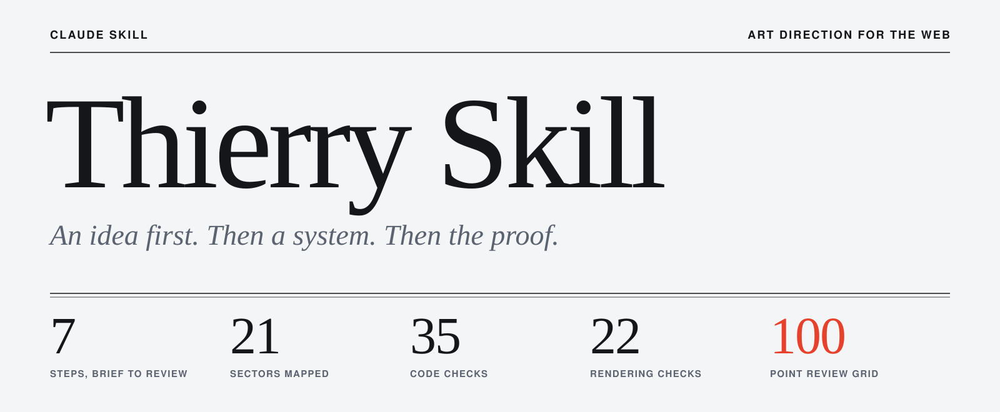
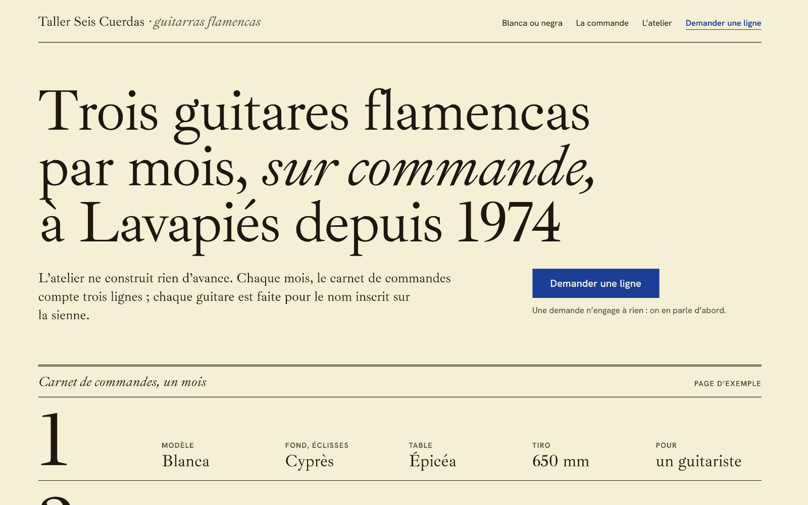
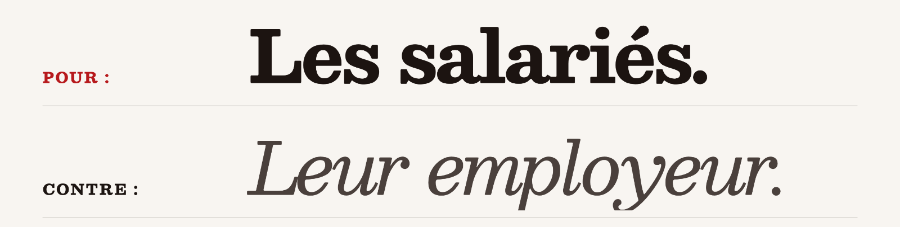
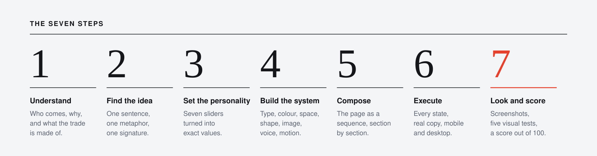
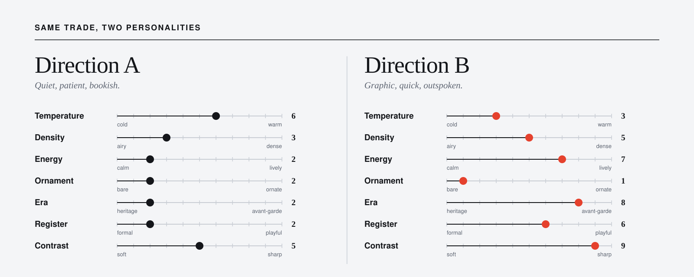
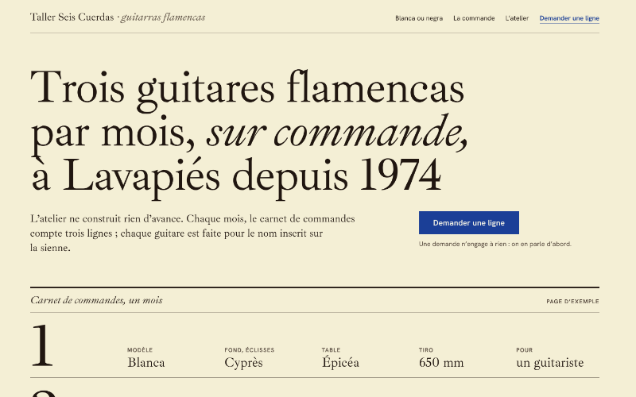
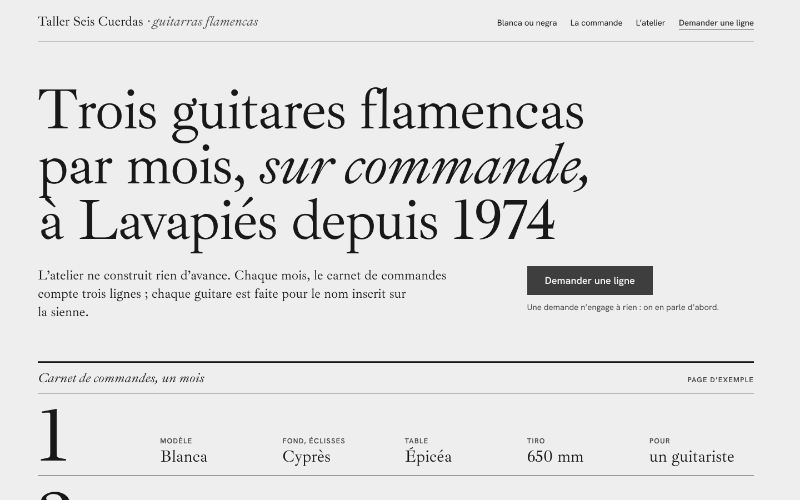
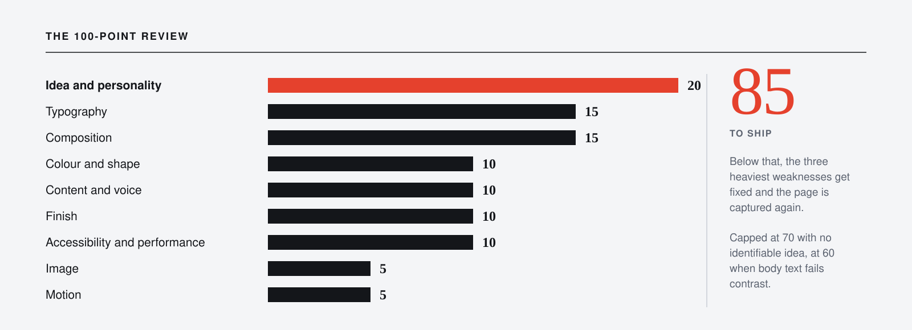

<p align="center">
  <a href="../README.md">English</a> ·
  <a href="README.fr.md">Français</a> ·
  <a href="README.de.md">Deutsch</a> ·
  <strong>Español</strong> ·
  <a href="README.it.md">Italiano</a> ·
  <a href="README.pt.md">Português</a>
</p>

<p align="center">
  
</p>

# Thierry Skill

**Un director de arte para Claude.** Con este skill, Claude diseña sitios web como lo hace un buen estudio: encuentra una idea en el oficio del cliente, deduce de ella un sistema visual completo, construye el sitio, mira el resultado en pantalla y lo puntúa antes de darlo por terminado.

[](../LICENSE)


```bash
npx skills@latest add Jacckisback/thierry-skills
```

## El problema

Los agentes de IA escriben código de interfaz correcto. Les falta un punto de vista. Pide «un sitio bonito y moderno» y obtendrás la media de todos los sitios: la misma tipografía, el mismo degradado morado, las mismas tres tarjetas con iconos. Nada está mal y nada se recuerda.

Los skills de diseño existentes pulen sobre todo la superficie: curvas, duraciones, microinteracciones. Ese trabajo importa, pero va al final. Un sitio con animaciones perfectas y sin idea sigue siendo una plantilla.

## Lo que cambia este skill

Obliga a Claude a responder tres preguntas, en orden, antes de añadir ningún efecto:

1. **¿Cuál es la idea?** Una frase que diga algo preciso sobre este cliente y que el sitio de un competidor no podría decir.
2. **¿Cuál es el sistema?** Tipografía, color, espacio, forma, imagen, voz y movimiento, todos deducidos de esa idea.
3. **¿Funciona en pantalla?** Capturas en tres anchos, medidas y puntuadas.

Dos encargos de una sola frase, dos resultados sin relación:

<table>
  <tr>
    <td width="50%"></td>
    <td width="50%"></td>
  </tr>
  <tr>
    <td><em>«Un sitio para un guitarrero de guitarras flamencas en Madrid, tres guitarras al mes, por encargo.»</em><br>Idea: el libro de encargos del taller. Tres líneas al mes, y una puede llevar tu nombre.</td>
    <td><em>«Un sitio para una abogada laboralista de Lyon que solo defiende a trabajadores.»</em><br>Idea: un escrito judicial. «A favor: los trabajadores. Contra: su empleador.»</td>
  </tr>
</table>

Las dos páginas las generó el skill durante sus pruebas, a partir de encargos ficticios. Puntuadas con su propia rejilla, obtuvieron 81 y 82 sobre 100. Quedan por debajo de su umbral de 85, sobre todo porque un encargo de una frase no trae fotos reales, precios ni pruebas, y el skill marca esos huecos como «por aportar» en lugar de inventarlos.

## La dirección de arte, explicada

Un sitio es bello cuando se cumplen tres cosas a la vez:

- **Una idea.** Dice algo concreto sobre su tema.
- **Un sistema.** Cada decisión visual se deriva de esa idea, y las decisiones se responden entre sí.
- **Una ejecución.** Cada detalle invisible está bien: alineaciones, estados, ritmo, velocidad, accesibilidad.

La mayoría de los sitios fallan en lo primero y lo compensan con efectos. Un efecto nunca es una idea.

El skill busca la idea en aquello de lo que está hecho el oficio: sus objetos, documentos, gestos, lugares, materiales, palabras y medidas. Un vinatero tiene etiquetas y notas de cata. Una arquitecta tiene planos y secciones. Un abogado tiene escritos. Esas formas ya pertenecen al cliente, así que un sitio construido con ellas no puede confundirse con el de otro.

La prueba central es la del **logo cambiado**: sustituye el logo por el de un competidor directo. Si el sitio sigue funcionando, no hay idea, y el trabajo vuelve a empezar.

<p align="center">
  
</p>

*Los siete pasos: comprender, encontrar la idea, ajustar la personalidad, construir el sistema, componer, ejecutar, mirar y puntuar.*

### La personalidad en números

«Cálido», «serio» o «atrevido» no le dicen nada a una hoja de estilos. El skill coloca siete controles de 0 a 10 (temperatura, densidad, energía, ornamento, época, registro, contraste) y convierte cada uno en parámetros concretos: radios, pesos, interletraje, duraciones, márgenes, saturación. Dos negocios del mismo sector reciben ajustes distintos, y de ahí sale el trabajo a medida.

<p align="center">
  
</p>

## En cifras

| | |
| --- | --- |
| **7** | pasos, del encargo a la revisión |
| **9** | leyes que el skill nunca incumple si no se le pide |
| **7** | controles de personalidad, cada uno convertido en valores exactos |
| **21** | sectores, con lo que espera el visitante, los tópicos que evitar y dos direcciones opuestas |
| **10** | arquitecturas de primera pantalla entre las que elegir |
| **11** | archivos de referencia, unas 30 000 palabras, que se cargan solo cuando hacen falta |
| **6** | idiomas con reglas tipográficas: francés, español, alemán, inglés, italiano, portugués |
| **35** | comprobaciones estáticas del código (`audit.mjs`) |
| **22** | comprobaciones de la página renderizada (`regard.mjs`) |
| **100** | puntos en la rejilla de revisión, en 9 ejes ponderados |

## Comprueba su propio trabajo

Un diseño juzgado solo leyendo código no ha sido juzgado. El último paso es obligatorio: capturar, mirar, puntuar, corregir.

`regard.mjs` abre la página en un navegador real en tres anchos. Guarda la primera pantalla, la página completa, tramos legibles, una versión en escala de grises y una versión desenfocada, y después mide lo que al ojo se le escapa.

<table>
  <tr>
    <td width="33%"></td>
    <td width="33%"></td>
    <td width="33%"></td>
  </tr>
  <tr>
    <td><strong>Primera pantalla.</strong> La prueba de los cinco segundos: ¿qué recuerda un desconocido?</td>
    <td><strong>Escala de grises.</strong> ¿Se sostiene la jerarquía sin el color?</td>
    <td><strong>Desenfocada.</strong> La prueba de entornar los ojos: una masa dominante, luego una segunda, luego el resto.</td>
  </tr>
</table>

En cada pasada se mide: el contraste del texto según los umbrales WCAG, el desbordamiento horizontal, las zonas táctiles por debajo de 24 y 44 px, la longitud de línea, las familias y tamaños de fuente realmente mostrados, las fuentes que no cargaron, las imágenes sin dimensiones o sin texto alternativo, la estructura de títulos, los campos sin etiqueta, los saltos de maquetación y lo que sigue moviéndose cuando el visitante ha pedido menos movimiento.

`audit.mjs` lee el código fuente y señala vicios de plantilla y fallos de ejecución: `transition: all`, entradas desde `scale(0)`, anillos de foco eliminados, degradados morados, texto de relleno, botones con etiquetas vagas, puntuación francesa incorrecta.

Después la página se puntúa. Por debajo de 85, se corrigen las tres debilidades más graves y se vuelve a capturar.

<p align="center">
  
</p>

*La rejilla: idea y personalidad 20, tipografía 15, composición 15, color y forma 10, contenido y voz 10, acabados 10, accesibilidad y rendimiento 10, imagen 5, movimiento 5.*

## Qué puedes pedir

| Tú dices | El skill entrega |
| --- | --- |
| «Crea un sitio para…» | una ficha de dirección de arte, el código y una revisión sobre capturas |
| «Rehaz este sitio» | un diagnóstico, lo que se conserva, una dirección nueva, un antes y después |
| «¿Qué te parece?» | una nota sobre 100 y correcciones ordenadas, sin modificar nada |
| «Púlelo» | acabados que no tocan el concepto |
| «Parece genérico», «parece hecho por IA» | la lista de vicios detectados y lo que sustituye a cada uno |
| «Dame opciones» | tres direcciones que difieren en el concepto, no en el color |
| «Prompt para Lovable» | un prompt listo para pegar en Lovable o en otro generador |

## Instalación

```bash
npx skills@latest add Jacckisback/thierry-skills
```

O a mano: copia `skills/thierry-skill` en la carpeta `.claude/skills/` de tu proyecto, o en `~/.claude/skills/` para tenerlo en todas partes. En las aplicaciones de Claude, comprime la carpeta `skills/thierry-skill` en un `.zip` y súbelo en los ajustes de skills.

Los dos scripts necesitan Node 18 o posterior. `regard.mjs` necesita además Playwright con Chromium:

```bash
npm i -D playwright
```

```bash
npx playwright install chromium
```

## Uso

Basta una frase:

> Usa thierry-skill: crea la página de inicio de una tienda de vinos naturales en Madrid.

El skill está escrito en francés y responde en el idioma en que le escribas. Construye sitios en cualquier idioma.

Los scripts también se pueden lanzar a mano:

```bash
node skills/thierry-skill/scripts/regard.mjs http://localhost:3000 --out revision
```

```bash
node skills/thierry-skill/scripts/audit.mjs ./src
```

## Contenido

```
skills/thierry-skill/
├── SKILL.md                         proceso, leyes, formatos de salida
├── references/
│   ├── 01-direction-artistique.md   concepto, firma, tabla de conversión de los controles
│   ├── 02-univers-par-secteur.md    21 sectores: expectativas, tópicos, dos direcciones
│   ├── 03-typographie.md            elección, combinación, escala, ajuste fino, carga
│   ├── 04-couleur.md                paletas en OKLCH, contraste, modo oscuro
│   ├── 05-composition.md            espacio, retícula, primera pantalla, imagen, móvil
│   ├── 06-mouvement.md              cuándo animar, curvas, duraciones, coreografía
│   ├── 07-finitions.md              estados, formularios, accesibilidad, rendimiento, SEO
│   ├── 08-anti-generique.md         los vicios «hecho por IA» y su sustituto
│   ├── 09-ecriture.md               titulares, botones, tipografía en seis idiomas
│   ├── 10-revue.md                  la rejilla de 100 puntos y el formato de revisión
│   └── 11-brief-lovable.md          plantilla de prompt con un ejemplo completo
├── assets/tokens.css                variables CSS neutras para adaptar
└── scripts/
    ├── regard.mjs                   capturas y mediciones
    └── audit.mjs                    auditoría estática del código
```

## El objetivo

Sitios que solo puedan pertenecer a su dueño. Un visitante debería poder describir el sitio de memoria al día siguiente, y el cliente debería reconocer en él su propio oficio. El skill trata la belleza como el resultado de la precisión: una idea verdadera, un sistema estricto y una prueba en pantalla.

## Límites

- No sustituye el contenido del cliente. Sin fotos, precios y pruebas reales, marca los huecos y la nota queda limitada.
- Las direcciones por sector son puntos de partida. Usadas tal cual, darían el mismo sitio a todos los negocios de un sector.
- Los scripts dan indicios que hay que comprobar a ojo. No prueban la navegación con teclado, los estados de formulario ni los lectores de pantalla.
- Los resultados dependen del modelo que ejecuta el skill y, por ahora, solo se han probado con dos encargos.

## Origen

Este skill nació del estudio detallado de los [skills de Emil Kowalski](https://github.com/emilkowalski/skills), que tratan la animación y el detalle de interfaz con gran precisión. Amplía el campo a la dirección de arte completa y añade la verificación del resultado en pantalla. Todo el texto y el código son originales.

## Licencia

[MIT](../LICENSE)
